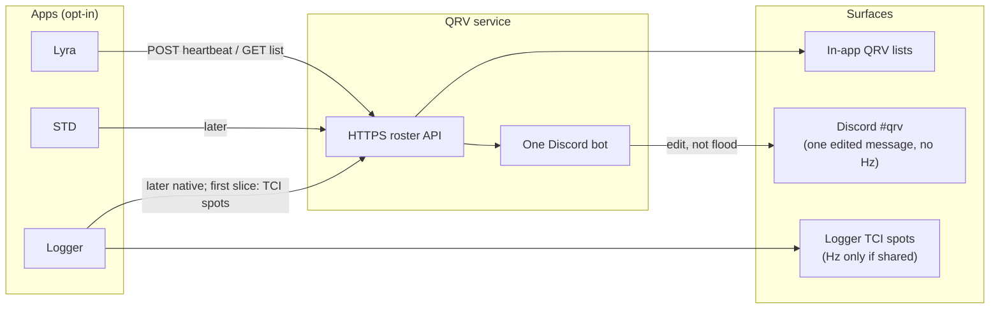

# QRV board (community presence) — plan

**Date:** 2026-11-15
**Status:** first slice **shipped in v0.25.43 Alya**. This file is the design record.
**Canonical spec:** this file.

This is an operator + implementer plan. Locked vs later is called out in
place. Do not treat “later” items as first-slice work.

---

## 1. Problem (why Thetis Discord Link is not the model)

Thetis 2.10.3.x “Discord Link” is **not** a live operator roster. It is a
client-side Discord Gateway websocket using a **bot token shipped in every
client**, plus a 12-button command box (CQ / QRV / QRT / QSY / …) that posts
into `#thetis-bot`, often with **exact MHz**, and a **10-line meter ticker**
as the UI.

That design dies for reasons that are structural, not “needs polish”:

| Failure | Why it matters |
|---|---|
| Discord Gateway is a firehose | Identify / session limits, reconnect storms, no operator-facing timeout on the channel |
| Shared bot token in every client | Token ends up on GitHub; anyone can impersonate the bot |
| Wrong UI | Meter ticker is not a roster; 12 manual buttons are a command box, not presence |
| Exact Hz on a public Discord channel | Frequency is PII for a ham; do not publish it there |
| No logger hook | Presence without “who is actually on and work-able from the log/spot surface” is a toy |

**Do not clone Thetis Discord Link.** Study it only as a negative example.

---

## 2. Product (locked)

**Opt-in QRV board.** Default **OFF**. Operators publish a small presence
record so other Lyra / Logger / STD operators can see who is QRV.

Published fields (first-class):

| Field | Notes |
|---|---|
| Call | Required when opted in |
| Band | From radio state (not VFO spin) |
| Mode | From radio state |
| App badge | `Lyra` / `Logger` / `STD` |

**Exact Hz** is a **second** checkbox, default **OFF**. Hz is **never on
Discord**. Click-to-tune in Lyra (or a clickable Logger spot) only if Hz was
shared.

**Be honest about who can see Hz** (review 2026-11-15). The roster `GET` is
reachable by anyone with the service URL, and the URL ships in the
installer — so a shared Hz is readable by anyone using the QRV service, not
"apps only" in any protected sense. Checkbox wording: *"Share exact
frequency (visible to anyone using the QRV service; never posted to
Discord)."*

Heartbeat: ~**60 s**, plus on **band/mode change** (debounce ~**10 s**). Not
on every VFO tick. Stale cutoff: ~**3 minutes** (drop from roster).

Going QRT is **explicit**, not just "wait for stale": Lyra sends a remove
request when the operator stops the stream, the radio disconnects, Lyra
closes, or the operator opts out. No heartbeats while Lyra is not connected
to a radio.

Roster entries are keyed by **call + app** (or call + install), so the same
operator on Lyra and Logger — or two Lyra installs — do not overwrite each
other.

Optional note: short (cap ~40 chars), plain text only (strip markup,
mentions, links). Shown in-app; **not posted to Discord** (abuse vector).

Talking stays in Discord `#general`. The QRV surface is presence, not chat.

---

## 3. Architecture

Lyra (and later STD / Logger) never talk to Discord. They HTTPS POST to a
**QRV service**. One bot, running **on that service**, **edits a single**
`#qrv` message. No line per tune. No Hz on Discord.

Operators **do not need a Discord account to publish from Lyra**. Viewing
`#qrv` in Discord **does** require a Discord account — that is Discord’s
rule, not ours.



ASCII equivalent:

```
Lyra  ──┐
STD   ──┼── HTTPS ──► QRV service ──► in-app lists (Lyra / later Logger / STD)
Logger──┘                 │
                          └── one bot edits Discord #qrv (strip Hz)

Logger Combo (first slice): GET roster → TCI spots
  Hz present  → clickable spot
  Hz absent   → no fake 1 Hz row
```

Lyra stores **only a service URL** in Settings (plus opt-in, call, Hz
checkbox, optional note, and the per-install key from §3.1). Moving the
service later (another host or domain) is just a URL change.

### 3.1 Anti-impersonation and abuse (review 2026-11-15 — required)

Publishing needs no Discord account and the URL is public, so without a
key anyone could post as any callsign: fake operators, roster spam, or a
fake click-to-tune row that sends someone's radio to a frequency of the
attacker's choosing.

| Measure | Detail |
|---|---|
| Per-install key | On first opt-in the service issues a random key and binds it to the callsign. Later posts for that call must carry the key. First come, first served; Rick can reset a binding. |
| Rate limits | Per key and per IP. Reject heartbeats faster than ~1 per 10 s. |
| Ban list | Service-side list of keys / calls / IPs, controlled by Rick. |
| Input checks | Callsign format check; band and mode from a fixed list; Hz within the band; note per §2. |

This is not callsign verification (no QRZ / LoTW check). It stops casual
impersonation and spam, which is the realistic threat.

### 3.2 Service build on Hostinger (decided 2026-11-15)

Runs on Rick's existing **Hostinger Premium** web hosting (paid through
2028-07; two PHP/HTML sites, ~5% resource use). Plain PHP + MySQL — no
Node "Web App" (that needs the Business plan) and no always-running bot
process.

| Piece | How |
|---|---|
| Address | A subdomain on an existing site, e.g. `qrv.rslcomputers.com`, with Hostinger's free SSL. |
| API | PHP scripts for `/v1/heartbeat`, `/v1/qrt`, `/v1/roster` (§3.3). |
| Roster storage | One MySQL table: call, app, band, mode, Hz, note, last-seen, key. "Stale after ~3 min" is a `last_seen` filter; old rows deleted by the cron job. Keys, bindings, rate-limit counters and the ban list in MySQL too. |
| Discord `#qrv` | A Hostinger **cron job** runs a PHP script ~once a minute: read the roster, and if it changed, edit the one `#qrv` message through Discord's ordinary REST API (`PATCH` the message). No Gateway connection. |
| Discord size | One message is limited to 2,000 characters — sort and truncate, ending with "+N more". |
| Load | 50 operators at one heartbeat a minute is under one request a second — trivial for the plan. Lyra still polls `GET` **only while the QRV window is open**, no faster than ~60 s. |

**Check on the plan before building:**
1. **Cron interval** — the shortest interval Premium allows (Advanced →
   Cron Jobs). Every minute is ideal; every 5 minutes still works (only
   `#qrv` updates less often; the in-app list does not depend on cron).
2. **Bot protection** — a test `POST` from a script (not a browser) must
   reach the PHP page without a challenge or block. Turn the protection
   off for the QRV subdomain if needed.
3. **Outbound HTTPS** — a PHP script on the site can call
   `discord.com`.
4. **PHP / MySQL** versions available on the plan.

### 3.3 API shape

Versioned from the start: `/v1/heartbeat` (POST), `/v1/qrt` (POST — remove
me), `/v1/roster` (GET). A later host move or format change then does not
break old installs.

---

## 4. Lyra UX (locked)

| Surface | Behavior |
|---|---|
| Settings → Network (or similar) | Opt-in (default OFF), callsign, “share exact Hz” (default OFF), optional note, service URL |
| **Separate floating / dockable window** | Same class as Tuner-CW / PureSignal: open, close, move, resize |
| Closed unless opened | **View → QRV**. Not a face-full ticker on the radio |
| Click-to-tune | Only if that row shared Hz |
| Toolbar chip | Optional **later**. Not first slice |

Do not put a 10-line Discord-style meter on the main faceplate.

**Never block the radio.** All QRV network calls are asynchronous, with
short timeouts and back-off on failure, and never run on the audio or wire
threads. A dead or slow service only makes the QRV window say
"unavailable".

**Privacy note in Settings.** One line saying what is sent (call, band,
mode, app, Hz only if ticked, note), where (the QRV service URL), and that
the service sees the operator's IP address (the host's web logs record
it).

---

## 5. Discord (locked)

| Rule | Detail |
|---|---|
| Publish path | Lyra → QRV HTTPS. **Lyra never talks to Discord** |
| Account | No Discord account required to **publish** from Lyra |
| View `#qrv` | Discord account required (Discord’s rule) |
| Bot | **One** bot identity, used only by the service's cron script. Token **only** in a config file on Hostinger outside `public_html` |
| Channel | Single `#qrv` message, **edited** in place |
| Content | Call, band, mode, app badge. **No Hz. No note. No per-tune lines.** Truncate with "+N more" past 2,000 characters. |
| Chat | Stays in `#general` |

### 5.1 Rick Discord setup (when building — walkthrough later)

Not a Gateway tutorial. He does not need to learn the Discord Gateway.

1. Create `#qrv` on the existing Lyra / Logger / STD server.
2. Discord Developer Portal → application → Bot → copy the token into the
   service's config file on Hostinger, **outside `public_html`** (never in
   a web-reachable folder).
3. Invite the bot to that server, **those channels only**.

Token never in: Lyra installer, Logger, STD, or GitHub.

---

## 6. Hosting (LOCKED — revised 2026-11-15)

**Start on Hostinger**, Rick's existing Premium plan (§3.2). It was already
the intended long-term home, and it is paid for through 2028, so starting
there skips a migration. (The earlier plan was a Cloudflare Workers free
tier test first; dropped — its free-tier write and request limits needed
workarounds, and Hostinger has none of them.)

**Do not start on Fly / a VPS.** Shared PHP hosting is enough.

**Account security:** turn on **two-factor authentication** on the
Hostinger account before the bot token goes on it (currently disabled).
Crop personal details (address, phone, email) from any Hostinger
screenshots shared publicly.

---

## 7. Secrets (locked)

| Location | Bot token |
|---|---|
| Hostinger config file outside `public_html` | **Yes — only here** |
| Lyra installer / source | Never |
| Logger / STD | Never |
| GitHub | Never |

Shared-token-in-client is how Thetis Discord Link became a liability.
Do not repeat it.

---

## 8. Logger / STD (same roster, not a second product)

One roster. Three clients over time. Each app: Settings + optional floating
panel (Logger native pane is later).

| Slice | What |
|---|---|
| **First** | Lyra + QRV service + `#qrv` |
| **First (Combo)** | Logger gets rows as **TCI spots** when Combo is up: Hz → clickable spot; **no Hz → do not invent 1 Hz** |
| **Later** | STD heartbeat, badge `STD` |
| **Later** | Logger native QRV pane |

---

## 9. Leaderboard (separate opt-in — **not first slice**)

Do **not** ship until QRV is actually used.

| Rule | Detail |
|---|---|
| Source | Weekly QSO totals from **Logger** |
| Count | **Lyra- / STD-sourced** QSOs only — not random ADIF dumps |
| Discord `#leaderboard` | One **edited** weekly (or daily) message: call, count, mode family (**CW / SSB / DIG**), **no frequency** |
| 24 h rate | Lives in **Logger** (and maybe a Lyra chip later). **Not** a Discord ticker |
| Extra columns later | Days QRV, bands — so FT8 factories don’t own the board |
| Contest | Exclude, or a **separate** opt-in |

---

## 10. What not to build

- Thetis 12-button command box
- Shared bot token in any client
- 1 Hz (or any exact Hz) on Discord
- Auto-on in the installer (default OFF, stay OFF until the operator opts in)
- A `lyra.world` (or similar) public site as the product
- A Windows service
- Chat-in-Lyra
- Discord Rich Presence as the product
- App version as a headline field on the board

---

## 11. First slice (build when Rick says go)

Hz sharing **in-app** may be deferred for a thinner cut — optional in slice 1.
Discord still never gets Hz.

| # | Deliverable |
|---|---|
| 1 | PHP roster API on Hostinger (`/v1/...`, §3.3): heartbeat, QRT, roster, TTL (~3 min stale). Roster in MySQL (§3.2). Per-install key, rate limits, ban list, input checks (§3.1). |
| 2 | Cron job **edits** `#qrv` from the roster via Discord's REST API (**strip Hz and note**; truncate to fit) |
| 3 | Lyra Settings opt-in (honest Hz wording, privacy line) + floating QRV panel (View → QRV), async network only, explicit QRT, no heartbeat while disconnected |

**Success metric:** testers leave it **ON** for a week **and** click a row /
start a QSO from it.

Optional in slice 1 (implementer call, do not block the three rows above):

- Exact-Hz checkbox + click-to-tune
- Logger Combo TCI-spot feed (Hz → spot; no Hz → skip)

---

## 12. Open / parked (later)

| Item | Notes |
|---|---|
| Logger native pane | After Combo spots prove the roster is useful |
| STD client | Heartbeat + `STD` badge |
| Leaderboard | §9; wait for QRV usage |
| Hz in first slice | Can defer even in-app; never Discord |
| Toolbar chip | Optional polish after the floating window exists |
| Discord setup walkthrough | Written for Rick when building §5.1 — not a Gateway course |

---

## 13. Locked vs later (summary)

| Locked now | Later / parked |
|---|---|
| Opt-in QRV board, default OFF | Leaderboard |
| Call / band / mode / app badge | STD client |
| Hz = second checkbox, default OFF, never Discord | Logger native pane |
| Heartbeat ~60 s + band/mode (~10 s debounce); stale ~3 min | |
| Lyra HTTPS only; one bot edits `#qrv` | Toolbar chip |
| Hostinger Premium (PHP + MySQL + cron), subdomain e.g. `qrv.rslcomputers.com` | Extra leaderboard columns, contest split |
| Token only in a Hostinger config file outside `public_html` | Chat, Rich Presence, public website |
| Floating/dockable panel, closed unless View → QRV | Auto-on, Thetis button box |
| Per-install key bound to call; rate limits; ban list (§3.1) | Real callsign verification (QRZ / LoTW) |
| Roster in MySQL; cron job edits `#qrv` (§3.2) | |
| Versioned `/v1/` API; explicit QRT; entries keyed call + app | |
| Hz checkbox says "visible to anyone using the service" | |
